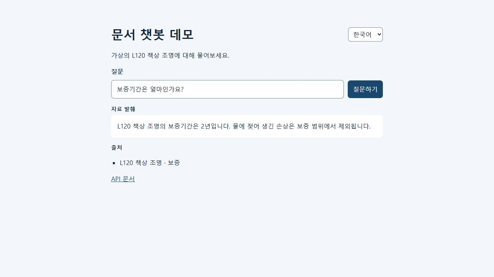
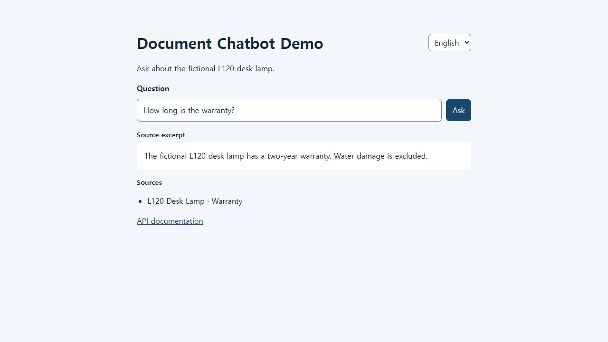

# 문서 챗봇 데모 · Document Chatbot Demo

한국어와 영어를 지원하는 로컬 FastAPI 데모입니다. PDF·Markdown·텍스트 파일에서 내용을 추출해 SQLite에 저장하고, 질문에 맞는 문서 구절을 찾아 출처와 함께 보여줍니다.

## 로컬 실행

Python 3.11 이상이 필요합니다.

```sh
python -m pip install -r requirements.txt
python run.py
```

[챗봇](http://127.0.0.1:7001/)에서 언어를 선택한 뒤 “보증기간은 얼마인가요?” 또는 “How long is the warranty?”를 입력해 보세요. 가상의 책상 조명 매뉴얼이 기본으로 등록됩니다.

## 실행 화면

두 화면은 Gemini 키 없이 샘플 문서에서 보증기간을 찾아 보여주는 **자료 발췌 모드**입니다.





## AI 연결과 내 문서 등록

1. `test.env`를 `.env`로 복사합니다. 실제 키와 업로드 토큰은 로컬 `.env`에 입력합니다.
2. `GEMINI_API_KEY`와 `GEMINI_MODEL`을 설정하고 앱을 재시작하면 Gemini가 검색한 문서 구절을 읽고 선택한 언어로 답변을 생성합니다. 질문과 관련 구절이 Gemini로 전송되므로 공개 또는 샘플 자료를 사용하세요.
3. 내 문서를 추가하려면 `DEMO_UPLOAD_TOKEN`을 설정합니다. 재시작 후 [API 문서](http://127.0.0.1:7001/docs)의 `POST /api/documents`에서 `X-Upload-Token`과 함께 2 MiB 이하 PDF·Markdown·텍스트를 올립니다. 업로드는 문서의 텍스트를 추출해 검색할 수 있게 등록하는 과정입니다. PDF의 스캔 이미지에는 OCR이 필요합니다.

내 문서를 등록하지 않아도 기본 샘플로 테스트할 수 있습니다. Gemini 키 없이도 등록된 문서의 구절을 보여줍니다. SQLite 데이터와 업로드 파일은 로컬 `data/`에 저장됩니다.

## English quick start

Run the installation commands above and open the [chat](http://127.0.0.1:7001/). Choose **English** or **한국어** in the language selector. The included fictional lamp manual is searchable in both languages, even without an API key.

For generated answers, copy `test.env` to `.env`, set `GEMINI_API_KEY` and `GEMINI_MODEL`, and restart. To add a PDF, Markdown or text file, configure `DEMO_UPLOAD_TOKEN` and use `POST /api/documents` with the `X-Upload-Token` header. Uploading indexes document text for retrieval. Gemini receives only the question and matching excerpts when configured.

## Test

```sh
python -m pytest -q
```
